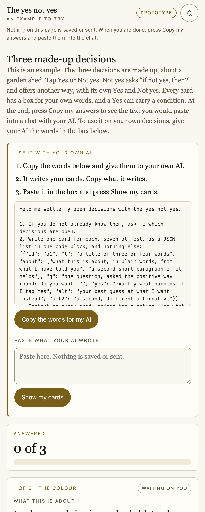

# The yes not yes

**A tap page for making decisions with your AI.** One card per open decision. Each card says what it is about, asks one question, and gives you three buttons: **Yes**, **Not yes**, **Explain this more**.

When you work with an AI, it asks you things, often as a wall of questions in the chat. You answer three, miss two and misread one. This page puts each decision on its own card, with its context first, so you can settle them one tap at a time, then paste your answers back into the chat.



**Try it:** download [`example.html`](example.html) and open it in any browser, or use the live example at [paulroebuck.co.uk/instruments/yes-not-yes](https://paulroebuck.co.uk/instruments/yes-not-yes).

## What each card does

1. **Says what it is about first.** Plain words, for someone who was not in the room when the question came up.
2. **Asks one question**, the positive way round: "Do you want this added?", never "Does this stay out?"
3. **Says what Yes means**: exactly what will happen if you tap it.
4. **Not yes is not a dead end.** It asks "If not yes, then?" and offers an alternative, with its own Yes and Not yes. Say no to that and it offers a second one.
5. **Explain this more** is an answer, not a dodge. The card comes back with more context.
6. **A box for your own words on every card**, even on a Yes. A Yes with words in the box is a Yes on a condition.

When you are done, **Copy my answers** gives you plain text to paste back to your AI:

```text
MY ANSWERS · The yes not yes · 26 Nov 2026, 17:46 · 3 of 3 answered
1. [shed-colour] The colour: Do you want the shed painted green?
   YES, ON A CONDITION. It gets painted green with the tin in the garage.
   My condition: Only before the frost
2. [shed-window] The window: Do you want a window added on the south wall?
   NOT YES. Instead, the second alternative: No window. A skylight in the roof instead.
3. [shed-shelves] The shelves: Do you want three shelves on the back wall?
   EXPLAIN THIS MORE. Come back with more context on a new card.
```

## Use it with your own AI (no code needed)

1. Open `example.html`.
2. Press **Copy the words for my AI** and paste them into a chat with your AI (Claude, ChatGPT, Gemini, any of them). The words are also in [`words-for-your-ai.md`](words-for-your-ai.md).
3. Your AI asks what you need to decide, then writes your cards. Copy what it writes.
4. Paste it into the page and press **Show my cards**. Tap your answers, press **Copy my answers**, and paste them back to your AI.

Nothing on the page is saved or sent anywhere. It is one HTML file with no outside scripts, fonts or tracking.

## Build your own page

You need Python 3. Nothing else.

```bash
python3 build.py examples/garden-shed.json --standalone -o my-page.html
```

A questions file looks like this (the full example is [`examples/garden-shed.json`](examples/garden-shed.json)):

```json
{
  "title": "The garden shed",
  "questions": [
    {
      "id": "shed-colour",
      "t": "The colour",
      "about": ["It is bare timber now.", ["a bullet", "another bullet"]],
      "q": "Do you want the shed painted green?",
      "yes": "It gets painted green with the tin in the garage.",
      "alt": "Leave it as bare timber and oil it instead.",
      "alt2": "Paint it, but a colour you choose from three sample pots first."
    }
  ],
  "ruled": [{ "t": "The roof", "a": "yes", "did": "New felt went on." }]
}
```

| Field | What it is |
|---|---|
| `id` | Letters, digits, `-` or `_`. **A reworded question gets a new id.** |
| `t` | A short title. |
| `about` | Required. The context, before the question. A list inside the list becomes bullets. |
| `q` | One question, asked the positive way round. |
| `yes` | Exactly what happens on Yes. |
| `alt`, `alt2` | The first and second alternatives offered after a Not yes. |
| `ruled` | Optional. Decisions already made, shown below a line at the foot of the page. |

Optional page settings: `title`, `strap`, `status`, `asker` (who is asking; "your AI" if not set), `paste` (`true` shows the "Use it with your own AI" box), `home` (the page's address, quoted in the words for your AI), and `text` to change the wording (`heading`, `lede`, `signature` and others; see the top of the script in `template.html`).

The builder refuses a card with no context or two cards with the same id. It warns when a question reads backwards. It never overwrites a different file.

### Saved mode, for Claude Artifacts

`--mode saved` builds a page meant to be published as a [Claude](https://claude.ai) Artifact with a database (`capabilities: {"db": {"rules": [{"path": "", "read": "owner", "write": "owner"}]}}`). Each answer is saved to the collection `rulings` as `{a, b, c, say, at}`: `a` answers the question, `b` the first alternative, `c` the second, each `"yes"`, `"no"`, `"explain"` (for `a` only) or empty; `say` is the typed words. Your AI reads them back instead of you pasting. Anywhere else, a saved-mode page keeps the answers on the device, and Copy my answers still works.

## Reading the answers (for the AI)

- **Yes**: settled. Do what Yes said.
- **Yes, on a condition**: only with the condition met. Not a plain yes.
- **Not yes. Instead, the first / second alternative**: settled that way.
- **Not yes, and left open**: change nothing. Read the words, then offer a better card under a new id.
- **Not yes. No second tap yet**: the person stopped part way. Not a decision. Ask what they are driving at.
- **Explain this more**: change nothing. Write the card again with more context, under a new id.
- Words typed in the box outrank the tap. Never ask again what a tap has settled.

## Where it came from

I'm Paul Roebuck, a psychotherapist. I built this with Claude in November 2026, while writing a book with AI. I said what I needed and the AI built it. Most of the rules on the card came from a card that failed me. My first page had five cards with no context; I tapped Not yes on all five and stalled. Hence rule one.

Over five days that book took 183 decisions, mostly one tap each. The story is on my blog: [A hundred and eighty-three decisions, mostly one tap at a time](https://paulroebuck.co.uk/blogai/the-yes-not-yes-pad).

It is a prototype. If you use it, I would like to hear where it helped and where a card missed the point: [paulroebuck.co.uk/contact](https://paulroebuck.co.uk/contact).

## Licence

MIT. Use it, change it, share it. Keep the copyright notice. See [`LICENSE`](LICENSE).
